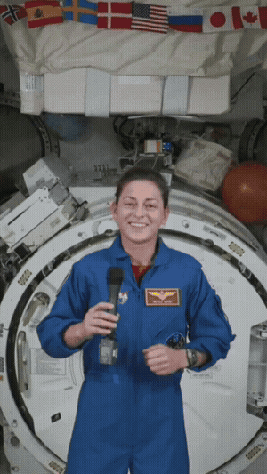

# clipkaro

Turn a long podcast, interview or YouTube video into vertical, captioned Shorts/Reels, on your own machine.

<p align="center"></p>
<p align="center"><sub>Demo footage: NASA (public domain).</sub></p>

- **Picks the moments**: transcribes the whole video, then scores sentence-aligned windows for a strong opening hook, dense speech and few dead pauses
- **Face-tracked 9:16 crop**: follows whoever is talking (detected from mouth movement) and keeps them centered
- **Word-by-word captions**: bold, burned-in, current word highlighted
- **English, Hindi or Hinglish**: Hinglish captions are written in Roman script ("kya bolte ho bhai"), not translated
- **Runs locally**: no uploads, no subscription. Uses your NVIDIA GPU if you have one, CPU otherwise

> Building this in public. Follow along on X: [@sahilgupta_1](https://x.com/sahilgupta_1)

## Install

Needs **Python 3.12** and **ffmpeg** on your PATH.

```bash
git clone https://github.com/Sahil-Gupta582/clipkaro.git
cd clipkaro
python -m venv .venv
# Windows: .venv\Scripts\activate    macOS/Linux: source .venv/bin/activate
pip install -r requirements.txt
```

Face-detection models download automatically on first run. For GPU speed you need CUDA 12 + cuDNN 9 (see [faster-whisper](https://github.com/SYSTRAN/faster-whisper#gpu)); without them it falls back to CPU.

## Use

```bash
# A YouTube link
python clipkaro.py "https://www.youtube.com/watch?v=VIDEO_ID" --count 5 --captions english

# A local file (recommended if YouTube downloads get blocked)
python clipkaro.py path/to/episode.mp4 --count 5 --captions hinglish
```

Clips land in `output/clip_01.mp4`, `clip_02.mp4`, ... (1080x1920).

| Option | Default | What it does |
|---|---|---|
| `--count` | 5 | Number of clips |
| `--captions` | `hinglish` | `english`, `hinglish` (Roman script) or `devanagari` (Hindi script) |
| `--language` | auto | Force the transcription language, e.g. `en`, `hi` |
| `--min-len` / `--max-len` | 30 / 90 | Clip length range in seconds |
| `--model` | `large-v3` | Whisper model. Use `small` or `medium` on CPU for speed |
| `--out` | `output/` | Output folder |
| `--small-copy` | off | Also write a copy under 10 MB per clip |
| `--stop-after` | | `download`, `transcribe` or `select`, to hand-pick clips |

### Hand-picking clips
Run with `--stop-after transcribe`, read `work/<id>/transcript.txt`, then write `work/<id>/clips.json`:

```json
[{"start": 140.5, "end": 174.7, "title": "Did you dream of space as a kid?"}]
```

Run the same command again without `--stop-after`. Everything is cached in `work/<id>/`, so re-runs only re-render.

## How it works
1. **Download**: `yt-dlp` (<=1080p) or copy a local file
2. **Transcribe**: `faster-whisper` with word timestamps
3. **Select**: sentence-aligned 30-90s windows scored by hook words/questions in the first 3s, speech density and pauses
4. **Render**: YuNet face detection + MediaPipe mouth landmarks to find the active speaker -> 9:16 crop, ASS captions burned in with ffmpeg (NVENC if available)

## Roadmap
- [ ] Hosted version: upload a file, get clips (no install)
- [ ] Better clip scoring with an LLM pass
- [ ] Caption style presets and logo overlay flag
- [ ] Split-screen layout for 2-person podcasts

## Notes
Only process videos you own or have the rights to repurpose.

## License
MIT
